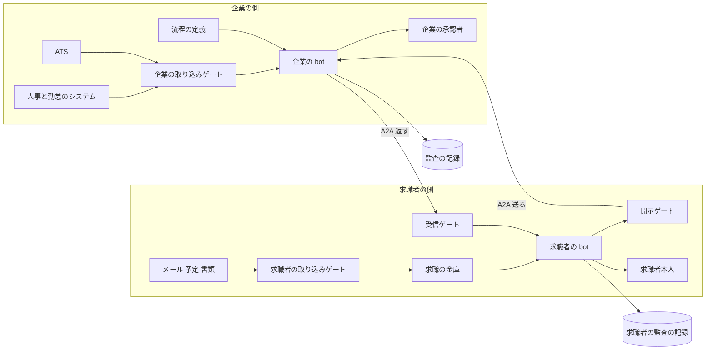
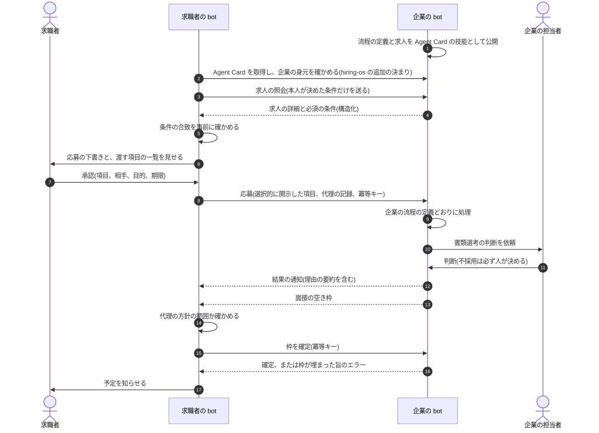

# hiring-os PRD(初版)

- 版: 初版、2026-11-11
- 状態: 運営者の合意の前の草案。子タスクは登録していない
- 根拠: [docs/research/](research/README.md)。各節の主張は、調べもののファイルと節を指す。出典の URL と見た日は、調べもののファイルにある
- 位置づけ: 新しい独立プロダクト。Prototype Studio(#269)と aica とは別に扱う

## 0. この文書の読み方

各項目に、次の 4 つの区分のどれかを付ける。

| 区分 | 意味 |
|---|---|
| 確定 | この初版で前提として固定するもの。種類は 3 つある。運営者の決定、法と前例から外せない制約、設計の原則(この版の前提。運営者の合意で最終の確定)。7.1 節の表に種類を書く |
| 仮説 | 正しいと見込んで設計に使うが、まだ確かめていないこと。確かめ方を付ける(7.2 節) |
| 未決 | 人が決める必要があり、まだ決めていないこと(7.3 節) |
| 対象外 | このプロダクトではしないこと。理由を付ける(7.4 節) |

## 1. 課題

### 1.1 企業はもう採用を管理しきれていない(仮説 H3)

- 出発点は運営者の考えだ。アルバイトでも正社員でも、企業は採用を管理しきれていない。流程を自動化しても、人が手でやる工程が残れば、そこがボトルネックになる。
- 調べものは、この考えと合う事実を示した。ただし「どの工程が一番のボトルネックか」は確かめていない。
  - 人材紹介の手数料は約 9,835 億円(2024 年度、前年度比 17.6% 増)。常用就職 1 件あたりの手数料は約 103 万円で、10.9% 上がった。企業は人が回す仲介に高い対価を払っている。[market.md「1. 市場の大きさ」](research/market.md)
    - ただし、この数字は医療、介護、保育を含む全職種の手数料だ。医療、介護、保育の紹介が大きな部分を占めると見られる(market.md の推測)。9.1 の対象(店舗のアルバイト)の負担の根拠としては弱い。アルバイトの負担は H3 で確かめる。
  - 米国の採用担当の 34% が、週の半分までをスパムやごみの応募の選別に使う(会社の調査)。[ai-hiring-tools.md「大量応募の実態」](research/ai-hiring-tools.md)
  - Indeed の CEO は、内定、条件交渉、入社手続きの自動化を「多くの顧客のシステムと連携すると遅くなる」として後回しにした。[job-platforms.md「経営の方針」](research/job-platforms.md)
  - 推測: Indeed の製品では、流程の後半は人の手に残っている。ただし Paradox の会話型 ATS は、現場職について内定と入社書類まで会話で扱う。[ai-hiring-tools.md「点の自動化か、流程全体か」](research/ai-hiring-tools.md)
  - 国内の ATS で、公開 API とスコープの文書を確かめられたのは HERP Hire だけだった。多くの中小企業は、bot から API で触れない道具で採用を回していると見込まれる(推測)。[ats.md「足りないこと」](research/ats.md)

### 1.2 データは企業の中に散らばり、bot に安全に渡す形がない

- 人事のデータ(従業員、組織、勤怠)は、多くのサービスで API から読める。ただしスコープはリソースと読み書きの単位で粗い。項目や対象者で絞れるのは HiBob、SmartHR、Rippling など一部だ。[hr-data.md「結論」](research/hr-data.md)
- 2026 年に出た MCP の多くは「サインインした人の権限を引き継ぐ」形だった。推測: 「普段は見られないデータを bot が見る」には、逆に広い権限のサービス用の鍵が要る。[hr-data.md「足りないこと」](research/hr-data.md)
- API の操作が監査ログに残ると公開文書で確かめられたのは、SAP SuccessFactors と Merge Agent Handler だけだった。[hr-data.md「結論」](research/hr-data.md)

### 1.3 大手は「自社の囲いの中」で AI ネイティブになろうとしている

運営者の考え「大手はまだ本当の AI ネイティブでない」を確かめた。結論は「一部は誤り、一部は正しい」だった。[research/README.md「結論」](research/README.md)

- 誤りだった所: 大手は AI のエージェントをすでに一般提供している。Indeed の応募の 70% は、AI の提案や、AI のデータにもとづくメールとポップアップなどから来る(会社の発表)。LinkedIn の Hiring Assistant はヒアリングから日程調整までをまたぐ。[job-platforms.md「Indeed」「LinkedIn」](research/job-platforms.md)
- 正しかった所: 大手のエージェントは、自社の求人と自社の候補者の中で動く。求職者の側の外部の AI への窓口は求人の検索だけで、応募は自社のサイトに戻す。求職者の bot による自動化は規約で禁じている。[job-platforms.md「横断の論点」](research/job-platforms.md)
- ただし企業の側は、自社の求人に限ったエージェントを汎用アシスタントの中に出し始めた。LinkedIn の Hiring Pro(中小企業向け)は、2026-10-21 から Claude の中で求人の原稿を作り、人の承認の後に掲載する。9.1 の対象(中小の店舗)に一番近い競合だ。[general-assistants.md「Claude」](research/general-assistants.md)、[job-platforms.md「LinkedIn」](research/job-platforms.md)
- この結論は主に米国の Indeed と LinkedIn の事実による。国内の大手(リクナビ、タウンワーク、Airワーク)の AI 機能は、一次情報に届いていない。[research/README.md「見つからなかったこと」](research/README.md)
- 確かめた範囲で誰も出していないもの(機会の候補)は 4 つある。
  1. 企業の中の複数のシステムをまたぎ、目的ごとに絞った権限で管理を代わりにやる bot
  2. 企業が採用流程そのものを自然言語で設計する仕組み
  3. 求職に関係するデータだけを見て、それ以外を遮断する求職者のアシスタント(近いものはある。違いは 5.3 節)
  4. 企業の bot と求職者の bot が直接やり取りする A2A

### 1.4 機会を狭める条件

| 条件 | 中身 | 根拠 |
|---|---|---|
| 職業安定法 | AI による自動処理でも、事業者の判断で選別、加工、連絡の差配をすれば職業紹介(許可が必要) | [regulation.md「1.2」](research/regulation.md) |
| 求職者からの課金 | 特定募集情報等提供事業者と有料職業紹介事業者は、原則として求職者から報酬を取れない | [regulation.md「1.1」](research/regulation.md) |
| 個人情報保護法 | 第三者提供と要配慮個人情報の取得は原則として本人の同意が要る。改正法(2026-07-17 公布)で課徴金が入る | [regulation.md「1.3」](research/regulation.md) |
| EU AI 法 | 採用の AI は附属書 III の高リスク。義務は 2027-12-02 から | [regulation.md「2.1」「2.2」](research/regulation.md) |
| 米国の訴訟 | Mobley v. Workday では、ベンダーが雇用主の代理人として責任を負いうるかが争われている | [risks.md「2. 訴訟」](research/risks.md) |
| 大手の規約 | 求職者の bot が大手のサイトで応募を自動化すると、規約とぶつかる | [job-platforms.md「横断の論点」](research/job-platforms.md) |

## 2. ビジョン

採用の流程を、企業の bot と求職者の bot が、それぞれの本人の決めた範囲の中で回す。人は「決める」所にだけ残る。

- 企業は、自分たちの採用流程を自然言語で書く。hiring-os は、それを決まった流程の定義に変え、その定義どおりに bot を動かす。
- 企業の bot は、目的ごとに絞った権限で社内のデータを読み、管理の手間を代わりにやる。何を読み、何をしたかは、すべて記録に残る。
- 求職者の bot は、求職に関係するデータだけを持つ。それ以外は仕組みで遮断する。何を誰に渡したかを、本人がいつでも見られる。
- 2 つの bot は A2A で直接やり取りする。求人の照会、条件の事前の確かめ、応募、面接の日程を、構造化したメッセージで行う。

設計の考え方は Stripe から借りる。[stripe-modular-agentic.md「このプロダクトへの示唆」](research/stripe-modular-agentic.md)

- 部品は単独でも組み合わせでも使える(既存の ATS を残して日程調整だけ使う、など)。
- 自然言語は設計の入口で、実行は決まった定義で行う。Stripe の「エージェントは考え、支払いはコードがする」を、採用の流程の実行に当てはめる(推測)。[stripe-modular-agentic.md「エージェント同士の取引」](research/stripe-modular-agentic.md)
- bot に渡す鍵は、資源ごとに読み書きを分け、重い操作は承認ルールで止める。

## 3. 利用者と体験

### 3.1 企業向け

#### 利用者

| 利用者 | 状況 | 欲しいこと |
|---|---|---|
| 小さな店舗の店長(アルバイトの採用) | 採用の担当は自分 1 人。応募への連絡と日程調整を、営業の合間に手でやっている | 連絡と調整を任せたい。採るかどうかは自分で決めたい |
| 中小企業の人事(正社員の採用) | 求人媒体、人材紹介、ATS、スプレッドシートを手でつないでいる | 流程を自社に合わせたいが、複雑な設定はできない |
| 大企業の採用担当と人事の管理者 | ATS と人事のシステムはあるが、部署ごとの例外が多い | 例外を含めた流程を、システムの改修なしに変えたい |
| 情報システムと法務 | bot にデータを渡すことに責任を持つ | 何を渡し、何が記録されるかを、渡す前に確かめたい |

#### 体験 1: 自然言語で採用流程を設計する(仮説 H2)

1. 利用者は流程を文章で書く。例: 「ホールのアルバイト。応募が来たら 1 時間以内に連絡。土日に入れる人を優先して、店長の空きに面接を入れる。採否は店長が決める」。
2. hiring-os は、それを流程の定義(起点、条件、手順、承認する人)に変え、図と文章で見せる。利用者は読み、直し、承認する。
3. 定義はサンドボックスで試せる。架空の応募者で流程を通して、どこで誰に何が届くかを確かめる。
4. 設計の段階で、違法や差別につながる条件を止める(確定 D11)。例: 性別の指定、本籍や家族を聞く質問。年齢の制限は、法が認める例外の事由(定年を上限にする、若年者の長期のキャリア形成など)を利用者が選んだ時だけ通し、選ばなければ止める。[risks.md「このプロダクトへの教訓」](research/risks.md)、[regulation.md「1.4」](research/regulation.md)
5. 承認した定義だけが本番で動く。定義には版を付け、いつ誰が変えたかを残す。

根拠と位置:

- 採用流程そのものを自然言語で設計できる製品は、確かめた範囲では見つからなかった。Ashby の Custom Agents(決まった流れのエージェントを自然言語で作る)と、Metaview の管理者の設定が近い。[ai-hiring-tools.md「点の自動化か、流程全体か」](research/ai-hiring-tools.md)、[ats.md「Ashby」](research/ats.md)
- 「企業が決めた基準を記録に残し、そのとおりに実行する」形は、職業紹介に当たらないための根拠にもなる(推測)。[regulation.md「このプロダクトへの示唆」](research/regulation.md)

#### 体験 2: 権限を渡した bot に管理を任せる(仮説 H1)

1. 管理者は、bot に渡す権限を「目的」の単位で選ぶ。例: 「欠員の検知には、部署、人数、勤怠の集計だけ」「面接官の割り当てには、氏名、所属、予定の空きだけ」。[hr-data.md「設計の方向」](research/hr-data.md)
2. 画面は、目的ごとに「読むデータ、読まないデータ、書く操作、その理由」を並べる。Stripe Apps の権限の画面と同じく、理由を見せてから同意を得る。[stripe-modular-agentic.md「5. 権限の設計」](research/stripe-modular-agentic.md)
3. bot がすること(例):
   - 勤怠と退職の予定から欠員を見つけ、求人の下書きを出す
   - 応募者への最初の連絡、書類の催促、面接の日程調整
   - 面接官の空きと評価の提出の催促
   - 内定の前の書類の準備(送るのは人の承認の後)
4. 重い操作は承認ルールで止める。不採用の通知、内定の送付、給与の提示、データの削除は、初めから人の承認が要る(確定)。Greenhouse MCP も、不採用や採用など 5 つの操作は人が確かめるまで動かない。[ai-hiring-tools.md「ATS が AI に口を開け始めた」](research/ai-hiring-tools.md)
5. 管理者は、bot が読んだもの、したこと、止められたことを、時系列で見られる。

### 3.2 求職者向け

#### 利用者

| 利用者 | 状況 | 欲しいこと |
|---|---|---|
| アルバイトを探す学生 | 複数の求人サービスに登録し、連絡がメールとアプリに散らばる | 合う求人を探し、日程の調整を任せたい |
| 転職中の正社員 | 在職中で時間がない。今の勤め先や私生活の情報は見せたくない | 応募の準備と調整を任せたい。何を誰に渡したかを把握したい |
| 汎用アシスタントをすでに使う人 | ChatGPT や Claude で応募書類を作っている | 汎用アシスタントにメールや全履歴を渡したくない |

#### 体験 3: 範囲を絞ったアシスタントに動いてもらう(仮説 H4)

1. 最初に「求職の金庫」を作る。職歴、資格、希望条件を入れ、必要なら外部のソースをつなぐ。つなぐ画面は、読むもの、読まないもの、その理由を並べる(5.3 節)。
2. アシスタントは求人を探す。並べ替えはするが、求人を自分の判断で隠さない。条件で絞るのは本人が決めた条件だけだ。説明は、求人の原文と、本人の条件との合致の表示にとどめ、求職者ごとに求人の文言を書き換えない。理由は職業安定法の区分にある(閲覧の並べ替えは職業紹介に当たらず、事業者の判断での選別と、相手に応じた情報の加工は当たる)。[regulation.md「1.2」](research/regulation.md)
3. 応募は「下書きと承認」から始める。本人が下書きを見て送る。Indeed も確認なしの自動応募のモードを止めた。[job-platforms.md「求職者向け」](research/job-platforms.md)
4. 本人が望めば、前もって「代理の方針」を決められる。例: 「時給 1,200 円以上、通勤 30 分以内なら、面接の日程の確定まで任せる」。方針の外は必ず本人に戻す。[a2a-and-permissions.md「このプロダクトへの示唆」](research/a2a-and-permissions.md)
5. 企業との連絡、面接の予定、結果は、金庫の中で 1 つの流れとして見られる。

## 4. A2A の流れ

### 4.1 全体の構成

- bot は元のデータを直接読まない。取り込みゲートが、目的と範囲に合う分だけを渡す(5 節)。
- 求職者の bot が外に出すものは、すべて開示ゲートを通る。開示ゲートは同意を確かめる。
- 企業の bot から来るものは、受信ゲートを通る。受信ゲートは構造化したスキーマで受け、指示ではなくデータとして扱う(確定 D9)。

### 4.2 応募から面接の確定まで

- やり取りの土台は A2A を使う(仮説 H5)。発見は Agent Card、やり取りはタスク、本人の確認は auth-required で表せる。採用の語彙(求人、応募、同意、選考の結果)は拡張として自分たちで決める。[a2a-and-permissions.md「A2A」「このプロダクトへの示唆」](research/a2a-and-permissions.md)
- 求人の型は schema.org JobPosting、職歴は LER-RS、資格は Open Badges 3.0 を借りる(仮説 H9)。[a2a-and-permissions.md「4」「5」](research/a2a-and-permissions.md)
- 面接の日程は、Stripe の予約の手引きの形(空きの検索、確定、構造化したエラー、冪等キー)を写す。最初に A2A にしやすい部品だ(推測)。[stripe-modular-agentic.md「サービスの予約」](research/stripe-modular-agentic.md)
- 相手の bot のメッセージは、指示ではなくデータとして扱う(確定 D9)。履歴書に隠した指示と同じ攻撃が A2A でも起きうる。[risks.md「履歴書にプロンプトインジェクションを埋める手口」](research/risks.md)
- 企業の bot が本物の企業のものかを確かめる方法は、A2A の仕様の外だ(Agent Card の署名は任意)。確かめ方は未決 U9 だ。[a2a-and-permissions.md「A2A」](research/a2a-and-permissions.md)
- 逆向きの信頼も要る。企業の bot が、求職者の bot の向こうに本人が本当にいるかを確かめる仕組みは、A2A にない。採用側は、AI や第三者を使って大量に応募する人を、なりすましとして止め始めている(Greenhouse)。米国の求職者の 41% が、応募でプロンプトインジェクションを使ったと答えた(会社の調査)。[ai-hiring-tools.md「大量応募の実態」「採用側の対策」](research/ai-hiring-tools.md)
  - 企業が求職者の bot からの応募を受ける理由は、まだない。受けるには、本人の確認、応募の数の上限、スパムの扱いが要る。確かめ方は未決 U10、企業が受け入れるかは仮説 H13 だ。
  - A2A は、片方の側だけでは価値が出ない。初版は企業の側から始める(9.1)。企業の日程の口を先に持ち、求職者の bot は後からつなぐ。
- 運営する事業者の前提: この節の図は、両方の bot を hiring-os が動かす形で描いた。両方を同じ事業者が動かすと、職業紹介の「あっせん」に一番近くなる。[regulation.md「1.2」](research/regulation.md) 片方を他の事業者の bot にする形もある。どちらにするかは、事業の区分(U1)と合わせて決める。
- どの段で「合う、合わない」を決めるかは未決 U1 だ。bot 同士が決めると、日本では職業紹介、EU では GDPR 第 22 条に近づく。[regulation.md「4」](research/regulation.md)

## 5. 権限とプライバシーの設計

### 5.1 共通の原則(確定。各行の D の番号は 7.1 節)

| 原則 | 中身 | 根拠 |
|---|---|---|
| 既定は拒否(D12) | 権限は初めはすべて「なし」。目的ごとに足す | [stripe-modular-agentic.md「制限付き API キー」](research/stripe-modular-agentic.md) |
| bot は別の実行者(D13) | bot には人と別の ID を付け、記録に「誰の代わりに、どの bot が」を残す | [a2a-and-permissions.md「RFC 8693」](research/a2a-and-permissions.md) |
| 重い操作は人が承認(D3) | 不採用、内定、給与の提示、データの削除、外部への開示。外部への開示の承認は、本人の開示の同意(5.3 節)で行う | [ai-hiring-tools.md「ATS が AI に口を開け始めた」](research/ai-hiring-tools.md) |
| AI であることを表示(D7) | 求職者や企業の担当者とやり取りする bot は、AI だと分かるようにする | [regulation.md「2.3」](research/regulation.md) |
| 集めない情報(D4、D5) | 要配慮個人情報、本籍、家族、思想、組合への加入などは、金庫に入れない、記録しない。検出のためにゲートが一時的に処理することはある(5.3 節)。顔、声、感情の分析はしない | [regulation.md「1.1」「1.4」「2.3」](research/regulation.md) |
| 監査の記録は自前で持つ(D8) | 元のサービスの監査ログに頼らない | [hr-data.md「足りないこと」](research/hr-data.md) |
| 全権の鍵を使わない(D10) | Stripe は 2026-12 から MCP で全権の鍵を受けつけなくする。同じく、bot が全権で動く道を作らない。ただし求職者のメールは、つなぎ方によっては鍵が全体の読み取りになる(5.3 節「鍵の範囲とゲートが守る範囲」) | [stripe-modular-agentic.md「MCP サーバーの認証」](research/stripe-modular-agentic.md)、[source-check.md #16](research/source-check.md) |

### 5.2 企業向け

- 鍵は 2 種類に分ける。担当者の権限で動く時は OAuth、担当者と離れて常に動く時は bot 用の鍵だ。どちらも環境ごと、接続先ごとに取り消せる。[stripe-modular-agentic.md「5. 権限の設計」](research/stripe-modular-agentic.md)
- 元のサービスのスコープが粗い分は、取り込みゲートで項目を落とし、集計で返す。評価のデータは個人の値ではなく集計で返すのを既定にする(仮説 H10)。[hr-data.md「設計の方向」](research/hr-data.md)
- SAP SuccessFactors のように、読み取り専用の権限がロールの権限を飛ばす抜け道もある。「読み取り専用だから安全」とは扱わない。[hr-data.md「SAP SuccessFactors」](research/hr-data.md)
- 顧客ごとにテナントを分け、ベンダーが勝手に見られないことを技術と契約の両方で決める。[risks.md「このプロダクトへの教訓」](research/risks.md)
- 判断に使ったモデル、流程の定義、プロンプトの版を記録する。Mobley v. Workday では、買収した機能(HiredScore)も訴訟の範囲に入った。[risks.md「このプロダクトへの教訓」](research/risks.md)

### 5.3 求職者向け

求職者向けの核は「見てよいのは求職に関係するデータだけ」だ。調べた汎用アシスタント 9 件には、データの中身の種類で範囲を決める設定が見つからなかった。[general-assistants.md「『求職に関係するデータだけを見せ、ほかは遮断する』はできるか」](research/general-assistants.md)

近いものは 2 つある。hiring-os の金庫と開示ゲートとの違いを書く。[ats.md「Workday Recruiting」「競合の見え方」](research/ats.md)

| 製品 | 近い所 | hiring-os との違い |
|---|---|---|
| Workday Candidate Profile(発表のみ、一般提供は 2027 年初めの予定) | 求職者が情報を一度保存し、各企業に何を見せるかを求職者が決める | Workday 経由の応募に限る。hiring-os は ATS をまたぎ、A2A で企業の bot に渡す |
| HERP Career(求職者向け、MCP で Claude とつなぐ) | 会話で求人を探し、希望をプロフィールに保存する | ats.md の記載の範囲では、外部のソース(メール、予定)を取り込んで求職の分だけに絞る仕組みはない。hiring-os の差はこの遮断と、渡した記録を相手ごとに見せること |

- 推測: どちらも「求職者がデータを持つ」方向は同じだ。Candidate Profile が一般提供されると、Workday を使う大企業の応募では、金庫の価値の一部が重なる。

#### 範囲の決め方

データを 3 つに分ける。初版の範囲は仮説で、利用者の検証で直す(仮説 H12)。

| 区分 | 中身 | 決め方 |
|---|---|---|
| A. 金庫に入れる | 職歴、学歴、資格、希望条件、応募した求人、企業とのやり取り、面接の予定、応募書類 | 本人が入れたもの、または B のゲートを通ったもの |
| B. 外部のソースのうち、求職に関係する部分 | メールは、応募した企業と求人サービスとのやり取りだけ。予定は空き時間(埋まっているかどうか)だけで、予定の中身は読まない。書類は本人が指定したフォルダだけ | 決まった規則で選ぶ(下を参照) |
| C. 常に遮断 | 要配慮個人情報(病歴、信条など)、本籍、家族、思想、組合への加入、金融の情報、勤め先の社内の情報、求職と関係のない人とのやり取り、位置の履歴 | 職業安定法の指針と個人情報保護法で集めない情報を基に、固定の一覧にする |

B を選ぶ規則:

- 規則は決まったものを先に使う。メールは「送信元が応募した企業か求人サービスのドメイン」「本文や件名に応募の ID がある」のどちらかを満たすものだけ。
  - 本文の ID を判定するには、取り込みゲートがメールの本文を読む。何を読める鍵が要るかは、下の「鍵の範囲とゲートが守る範囲」に書く。
- LLM の分類は「入れてよいか」の提案にだけ使う。提案は本人が承認するまで金庫に入らない。分からないものは入れない(既定は拒否)。
- 金庫に入れたものにも、C の情報が混ざることがある(例: 職務経歴書の家族の記載)。取り込みゲートは C を検出して伏せ、伏せたことを本人に知らせる。
  - 検出するには、ゲートが一度その中身を処理する。C は金庫に入れず、記録にも残さない(D4)。この一時的な処理が要配慮個人情報の「取得」に当たるかは確かめていない。扱いは未決 U12 で、C1 で確かめる。

根拠: 職業安定法の指針は、人種、本籍、思想、組合への加入などの収集を禁じている。本人以外から集める時は、本人の同意か本人が公開した情報などによる。[regulation.md「1.1」](research/regulation.md)

#### 遮断の仕組み

| 層 | 仕組み | 理由 |
|---|---|---|
| つなぐ口 | 外部のソースへは、使える中で一番狭い口でつなぐ。予定は空き時間の API だけ。メールは鍵では絞れないことがある(下の「鍵の範囲とゲートが守る範囲」)。ブラウザ全体の操作は初版では使わない | Gemini が手元の Chrome を使うと、本人がログインしているサイトすべてに入れる。[general-assistants.md「Gemini」](research/general-assistants.md) |
| 取り込みゲート | 元のデータは、ゲートの中で一度だけ処理する。B の規則に合う分と、C を伏せた結果だけを金庫に入れる。元のデータは残さない | アシスタントの LLM が元のデータに触れないようにする |
| 金庫と道具 | アシスタントの LLM は、金庫を型の決まった道具(求人の照会、応募の下書き、予定の空きの取得など)でだけ読む | 「何でも検索できる道具」を渡すと、範囲がつないだサービスの全体になる。[general-assistants.md「推測」](research/general-assistants.md) |
| 開示ゲート | 企業の bot に出すものは、同意(項目、相手、目的、期限)と照らしてから出す。同意の外は出さない | 求職者のデータを企業に渡すのは第三者提供に当たりうる。[regulation.md「1.3」](research/regulation.md) |
| 入ってくるもの | 企業の bot から来るメッセージは、指示ではなくデータとして扱う。構造化したスキーマで受ける | [risks.md「履歴書にプロンプトインジェクションを埋める手口」](research/risks.md) |
| 記憶 | 求職の記憶は、求職の金庫の中にだけ置く。モデルの学習には使わない | 汎用アシスタントの記憶は会話の全体から作られる。[general-assistants.md「推測」](research/general-assistants.md) |

#### 鍵の範囲とゲートが守る範囲

遮断には 2 つの層がある。混ぜずに書く。

- 鍵の範囲: 外部のサービスが hiring-os に許す範囲。外部のサービスが守る。
- ゲートが守る範囲: 鍵で読めるもののうち、金庫に入れる範囲。hiring-os のコードが守る約束だ。

メールでは、この 2 つがずれる。[a2a-and-permissions.md「例: Gmail の scope」](research/a2a-and-permissions.md)

- Gmail には、送信元や検索の条件で絞る scope がない。
- ヘッダーだけの `gmail.metadata` では、検索の条件(`q`)も本文も使えない。
- 本文を読むには `gmail.readonly` などの restricted scope が要る。Google の審査が要り、サーバーに保存するならセキュリティの評価も要る。
- Gmail 以外のメール(Outlook など)の scope は確かめていない。

つまり B の規則で本文を見るなら、鍵の上では hiring-os もメールボックス全体を読める。6 節で汎用アシスタントについて書いた「つないだサービスの権限の全体」と同じだ。差は、ゲートの約束と、その記録を本人が見られることだけになる。

メールのつなぎ方は未決 U11 だ。選択肢:

| つなぎ方 | 鍵の範囲 | 中身 |
|---|---|---|
| 転送 | 応募のメールだけ | 本人がメールの設定で、応募のメールだけを hiring-os の宛先に転送する。hiring-os はメールボックスの鍵を持たない。設定の手間は本人にかかる |
| 求職専用のアドレス | そのアドレスの全体 | 応募に使うアドレスを分けてもらう。全体を読んでも、中身はほぼ求職のメールだ。Gmail なら鍵は全体の読み取りと同じで、審査も要る |
| アドオン | 本人が開いたメールだけ | Gmail のアドオンとして、本人が開いて操作したメールだけを読む。自動の取り込みはできない |
| 全体の読み取り | メールボックス全体 | `gmail.readonly` で読み、ゲートで絞る。手間は一番少ない。審査が要り、鍵は汎用アシスタントと同じ広さになる |

#### 同意の取り方と取り消し

同意は 3 段に分ける。

| 段 | いつ | 何を見せるか | 取り消し |
|---|---|---|---|
| 1. つなぐ同意 | 外部のソースをつなぐ時 | 鍵で読めるもの、金庫に入れるもの、その理由。文は U11 のつなぎ方に合わせ、鍵の範囲をごまかさない。転送の例: 「あなたが転送したメールだけが hiring-os に届きます」。全体の読み取りの例: 「hiring-os はメールボックス全体を読める鍵を受け取ります。応募した企業からのものだけを金庫に入れ、ほかは残しません」 | いつでも切れる。切ると取り込みが止まり、そのソースから作ったデータを消す |
| 2. 開示の同意 | 企業の bot に初めて項目を渡す時 | 渡す項目、相手の企業、目的、期限。RFC 9396 の `authorization_details` の形で持つ(仮説 H11) | 相手ごとに取り消せる。取り消すと、A2A で相手に削除を求め、求めたことを記録する |
| 3. 代理の方針 | 本人が任せる範囲を決める時 | 条件(時給の下限、勤務地、件数の上限など)と、任せる操作(日程の確定など) | すぐに止まる。止める前の操作は記録で見られる |

- 既定は「毎回、本人が承認」だ。代理の方針は、本人が選んだ時だけ使う。
- D3 の「外部への開示は人の承認が要る」は、2 段目の開示の同意で満たす。同意の範囲(項目、相手、目的、期限)の中なら、送るたびの承認は要らない。3 段目の代理の方針では、開示の同意の外に開示を広げられない。広げるには、本人が開示の同意をやり直す。
- 代理の方針は、AP2 の mandate や Mastercard の Verifiable Intent と同じ形にする。本人が前もって条件に署名し、bot はその範囲でだけ動き、操作ごとに証拠を残す(仮説 H11)。[a2a-and-permissions.md「このプロダクトへの示唆」](research/a2a-and-permissions.md)
- 基盤モデルの事業者が外国にある時は、外国にある第三者への提供の同意と情報の提供が要りうる(個人情報保護法第 28 条)。扱いは未決 U6 だ。[regulation.md「1.3」](research/regulation.md)
- 渡した推定値で問題が起きた前例がある。リクナビ DMP フォローは、本人の同意なく内定辞退率を企業に渡した。hiring-os は、本人について推定したスコアを作って企業に渡さない(確定)。[risks.md「リクナビ DMP フォロー」](research/risks.md)、[source-check.md #18](research/source-check.md)

#### 監査の記録と利用者への見せ方

記録する項目(すべての bot の操作ごと):

- 誰の代わりに、どの bot が動いたか
- どの同意、どの代理の方針にもとづいたか
- 何を読み、何を渡し、何を決めたか
- 相手の bot の身元をどう確かめたか
- 人が確かめた場合は、その人と時刻

「何を読み」には、項目の種類と出どころを残し、C の中身は残さない。C を伏せた時は、伏せたことと C の種類(例: 「家族の記載」)だけを残す(D4)。

根拠: [a2a-and-permissions.md「6. 監査の記録の考え方」](research/a2a-and-permissions.md)

見せ方:

| 画面 | 中身 |
|---|---|
| 時系列 | 「読んだ、渡した、決めた、止まった」を時間の順に並べる |
| 相手ごと | 企業ごとに「この企業に渡したもの」と、その同意と期限を出す。ここから取り消せる |
| 週のまとめ | 先週、bot が代わりにしたことと、本人の承認を待っていることを短く知らせる |
| 書き出しと削除 | 記録と金庫を書き出せる。金庫を消せる |

- 保存の期間は未決 U5 だ。カリフォルニア州の規則は雇用の記録を 4 年以上残すとし、データの最小化とぶつかる。[regulation.md「3.1」](research/regulation.md)、[source-check.md #17](research/source-check.md)

## 6. 汎用アシスタントとの違い

| 観点 | 汎用アシスタント(調べた 9 件) | hiring-os の求職者の bot |
|---|---|---|
| 権限の単位 | アプリ、ツール、サイト | 求職に関係するデータの種類 |
| つないだ時に見える範囲 | つないだサービスの本人の権限の全体 | アシスタントの LLM は金庫に入った分だけで、元のデータに触れない。鍵の範囲はつなぎ方(U11)しだいで、全体の読み取りなら汎用アシスタントと同じ広さになる(5.3 節) |
| 範囲を決める人 | Claude の Team と Enterprise では、管理者がツールごとに決め、個人は上書きできない。推測: 個人のプランでは、ツールごとの細かい設定を本人が持てないことがある | 本人 |
| 記憶 | 会話の全体から作る。プロジェクトで分けられる製品もある | 求職の金庫の中だけ |
| 企業とのつながり | 求人サービスのアプリ(検索)まで。応募は求人サービスのサイトに戻る | 企業の bot と A2A で直接つながる |
| 渡した記録 | 製品ごとに違う | 相手ごと、項目ごとに本人が見られ、取り消せる |
| 法の上の位置 | 汎用の道具 | U1 しだい(道具の提供、特定募集情報等提供の届出、職業紹介の許可のどれか) |

根拠: [general-assistants.md「結論」「『求職に関係するデータだけを見せ、ほかは遮断する』はできるか」](research/general-assistants.md)

- 汎用アシスタントと戦うより、その中にも出る(仮説 H7)。hiring-os の MCP サーバーを「求職に関係するデータだけを返す口」として出す。求職者の側では、Indeed が ChatGPT のアプリと Claude 向けの MCP を出している。企業の側では、LinkedIn の Hiring Pro が Claude の中にある(1.3 節)。[job-platforms.md「外部の AI との連携」](research/job-platforms.md)[general-assistants.md「このプロダクトへの示唆」](research/general-assistants.md)
- 国内では LINEヤフーの Agent i が領域ごとのエージェントを増やしている。仕事探しの領域が足されると、強い相手になる(推測)。[general-assistants.md「国内: LINEヤフー」](research/general-assistants.md)

## 7. 確定・仮説・未決・対象外

### 7.1 確定

種類は「運営者の決定」「法と前例からの制約」「設計の原則」の 3 つ。設計の原則は、この版の前提で、運営者の合意で最終の確定になる。

「法と前例からの制約」は、最初の対象である国内(U2 の仮の値)で縛る法に限る。EU と米国に出るかは未決(U7)なので、EU と米国の法と判例に基づく項目は「設計の原則(EU と米国の法、前例から)」とする。国内の製品では縛る法にならず、作者が決めた原則だからだ。

| # | 項目 | 種類 | 理由 |
|---|---|---|---|
| D1 | Prototype Studio(#269)と aica とは別の独立プロダクトにする | 運営者の決定 | Goal |
| D2 | 文書は日本語で書く。hiring-os の中では企業名とサービス名を書いてよい | 運営者の決定 | Goal |
| D3 | 不採用、内定、給与の提示、データの削除、外部への開示は、人の承認が要る。外部への開示は、本人の開示の同意の範囲の中なら、その同意を承認とする。代理の方針で開示を広げない(5.3 節) | 設計の原則(EU と米国の法、前例から) | GDPR 第 22 条、Mobley v. Workday、Greenhouse MCP の前例 |
| D4 | 要配慮個人情報と、職業安定法の指針で集めない情報は、金庫に入れない、記録しない。取り込みゲートが検出のために一時的に処理することはある(法の扱いは U12) | 法と前例からの制約 | 職業安定法の指針、個人情報保護法 |
| D5 | 感情の推論をしない。顔と声の分析もしない | 設計の原則(EU と米国の法、前例から) | EU AI 法の職場での感情認識の禁止。HireVue の顔の分析の中止と CVS の訴訟 |
| D6 | 本人について推定したスコアを作って企業に渡さない | 設計の原則(前例から) | リクナビ DMP フォローの勧告と指導(source-check.md #18)。同意があれば違法とは限らないが、信頼を優先する |
| D7 | bot は AI であることを表示する | 設計の原則(EU と米国の法から) | EU AI 法第 50 条、コロラド州法(2026-06-30 の後の状態は確かめていない) |
| D8 | 監査の記録は hiring-os の側で持つ | 設計の原則 | 元のサービスの監査ログを外から読める例が少ない |
| D9 | 相手の bot のメッセージと候補者の文書は、指示ではなくデータとして扱う | 設計の原則 | 履歴書のプロンプトインジェクションの研究 |
| D10 | bot に全権の鍵を渡す道を作らない | 設計の原則 | Stripe の MCP の方針(source-check.md #16)、人事のサービスの抜け道 |
| D11 | 流程の設計の段階で、違法や差別につながる条件(性別の指定、本籍や家族を聞く質問など)を止める。年齢の制限は、法の例外の事由を利用者が選んだ時だけ通し、選ばなければ止める | 法と前例からの制約 | 労働施策総合推進法と施行規則第 1 条の 3 第 1 項(年齢の制限の例外の事由。regulation.md「1.4」)、男女雇用機会均等法、公正な採用選考、EEOC v. iTutorGroup |
| D12 | 権限の既定は拒否。目的ごとに足す | 設計の原則 | Stripe の制限付き API キー |
| D13 | bot は人と別の実行者として ID を持ち、誰の代わりに動いたかを記録する | 設計の原則 | RFC 8693 の委任、Stripe のエージェント用の鍵 |

D3〜D13 の根拠は 1.4 節、3.1 節、5 節の各行にある。運営者の合意が要るのは、設計の原則の D3、D5〜D10、D12、D13 だ。D11 の年齢の扱い(例外の事由を選ばせる)も、C3 で合意を得る。

### 7.2 仮説と確かめ方

| # | 仮説 | 確かめ方 |
|---|---|---|
| H1 | 企業は、目的ごとに絞られ、記録が見えるなら、普段は見られないデータへの読み取りを bot に渡す | 中小と大企業の人事と情報システムの担当に、権限の画面の試作を見せ、どの目的なら渡すかを選んでもらう。目的ごとに「渡す」の割合を見る |
| H2 | 自然言語で書いた採用流程を、決まった定義に変え、本人が読んで正しいと確かめられる | 実在の流程の記述 10 件(アルバイトと正社員)で変換の試作を作る。本人が直した回数と、サンドボックスでの食い違いを数える |
| H3 | 企業は採用を管理しきれておらず、人が手でやる工程がボトルネックになっている。一番の負担は連絡と日程調整だ(特にアルバイト) | 店舗と中小企業の採用担当に、1 週間の採用の作業を工程ごとに書き出してもらう。時間の多い順に並べ、漏れや遅れ(返信の遅れ、候補者の取りこぼし)が起きた工程を数える |
| H4 | 求職者は、範囲を絞ったアシスタントを、汎用アシスタントより信頼してデータを渡す | 2 つのつなぐ同意の画面(範囲を絞ったもの、全体をつなぐもの)を見せ、つなぐ割合と理由を比べる |
| H5 | 採用の A2A は、A2A の拡張(求人、応募、同意、日程の型)で表せる | 拡張の草案を書き、4.2 節の流れを A2A のタスクと状態で最後まで表せるかを机上で確かめる |
| H6 | 大手は、企業側の Agentic AI は受け入れ、求職者側の bot は規約で締め出し続ける | 大手の規約と API の変更を四半期ごとに見る。Indeed の規約の「Agentic AI」の記載の変化を追う |
| H7 | 汎用アシスタントの中のコネクタとして出す方が、単独のアプリより求職者に届く | MCP サーバーの試作を作り、汎用アシスタントからの利用と、単独の画面での利用を比べる |
| H8 | 判断を企業と本人に戻す設計なら、職業紹介の許可なしでも A2A の価値が残る | 区分の案を作り、都道府県労働局と弁護士に確かめる。そのうえで、残る機能で H3 の負担がどれだけ減るかを見積もる |
| H9 | 採用の型は既存の標準(schema.org JobPosting、LER-RS、Open Badges 3.0)を借りれば足りる | 実在の求人と職務経歴書を各 10 件、型に写す。写せない項目を数える |
| H10 | 評価のデータは、個人の値ではなく集計で返しても、bot の目的(面接官の割り当てなど)に足りる | 目的ごとに要る項目を書き出し、個人の値が要る目的があるかを洗い出す |
| H11 | 開示の同意は RFC 9396 の `authorization_details`、代理の方針は AP2 の mandate の形で表せる | 5.3 節の同意の 3 段を両方の形で書き、表せない条件を数える |
| H12 | 5.3 節の A、B、C の範囲は、求職者が「求職に関係する」と考える範囲と合う | 求職者に、架空のメールと予定の見本を「入れてよい / いけない」に分けてもらう。B の規則の判定との食い違いを数える |
| H13 | 企業は、本人の確認、応募の数の上限、本人の承認の証拠が付くなら、求職者の bot からの応募を受け入れる | 採用担当に、bot 経由の応募の見本(本人の確認と承認の証拠、上限つき)と、付かない見本を見せる。受けるか、何があれば受けるかを聞き、受ける割合を比べる |

### 7.3 未決

| # | 項目 | 選択肢 | 決める人 |
|---|---|---|---|
| U1 | 事業の区分 | 道具の提供にとどめる / 特定募集情報等提供の届出 / 職業紹介の許可。あわせて、企業の bot と求職者の bot の両方を hiring-os が動かすかを決める(4.2 節) | 運営者(労働局と弁護士の確認の後) |
| U2 | 最初の対象 | アルバイト / 正社員 / 両方。国内だけか | 運営者 |
| U3 | 既存の ATS との関係 | ATS の上に乗る部品 / 最小の ATS を自前で持つ | 運営者 |
| U4 | 収益の形 | 企業の月額 / 成果課金 / 求職者の課金(制約あり) | 運営者 |
| U5 | 監査の記録の保存期間 | 最小化を優先 / 法域の最長に合わせる(カリフォルニア州は 4 年以上) | 運営者と法務 |
| U6 | 基盤モデルの事業者と、データの置き場の国 | 国内 / 外国(第三者提供の同意の扱いが変わる) | 運営者 |
| U7 | EU と米国に出すか | 出さない / 後で出す(EU は 2027-12-02 から高リスクの義務) | 運営者 |
| U8 | A2A の拡張を公開するか | 非公開 / 公開して標準の場に出す | 運営者 |
| U9 | 企業の bot の身元の確かめ方 | Agent Card の署名を必須にする / 法人番号などで登録を確かめる / 両方 | 運営者 |
| U10 | 求職者の bot の身元と、人が本当にいるかの確かめ方 | hiring-os が本人を確かめ(電話番号など)、その印を応募に付ける / 本人が署名した承認の証拠を応募に付ける / 応募の数の上限を決めて企業に示す / 組み合わせ | 運営者(H13 の結果の後) |
| U11 | 求職者のメールのつなぎ方(5.3 節) | 転送 / 求職専用のアドレス / アドオン / 全体の読み取り(restricted scope の審査が要る) | 運営者 |
| U12 | 取り込みゲートが C を検出するための一時的な処理の扱い | 要配慮個人情報の「取得」に当たらない前提で設計する / 当たる前提で、つなぐ同意に含めて本人の同意を取る | 運営者(C1 で弁護士に確かめた後) |

### 7.4 対象外

| # | 項目 | 理由 |
|---|---|---|
| O1 | 実装(この PRD の段では) | Goal の範囲は調べものと PRD まで |
| O2 | 大手の求人サイトでの自動応募(ブラウザの自動操作) | 大手の規約が外部の bot による自動化を禁じている。[job-platforms.md「横断の論点」](research/job-platforms.md) |
| O3 | 本人が出していない外部データを集めて点数化するソーシング | Eightfold の FCRA の訴訟、リクナビの件。[risks.md「2」「3」](research/risks.md) |
| O4 | 不採用の自動決定 | D3 と同じ |
| O5 | 汎用アシスタントそのもの | 求職に限ることが差だから |
| O6 | 決済(求人広告の購入など) | 採用の多くは支払いを伴わない。SPT などは日本で使えない。[stripe-modular-agentic.md「このプロダクトへの示唆」](research/stripe-modular-agentic.md) |

## 8. 利用者の考えとの対応

| # | 利用者の考え | 扱った節 | 区分 | 扱い |
|---|---|---|---|---|
| 1 | 根本の問題は、企業がもう管理しきれていないこと。人が手でやる工程がボトルネックになる | 1.1、2 | 仮説 H3 | 課題として採った。調べものは合う事実を示したが、前提そのものと、どの工程が一番のボトルネックかは確かめていないので仮説にした。9.1 で確かめる |
| 2 | 企業向け: bot に一定の権限を与え、普段は見られないデータにアクセスさせ、管理を代わりにやらせる | 3.1 体験 2、5.1、5.2 | 仮説 H1、H10、確定 D3、D8、D10、D12、D13 | 採った。権限は目的ごとに絞り、重い操作は人の承認、記録は自前、の形にした。9.1 の最小の体験では人事のデータを読まないので、この項目は C2、C4、C5 で確かめる |
| 3 | 企業向け: 自社の採用流程を自然言語で設計できる。Stripe のモジュール化と agentic design が着想の元 | 2、3.1 体験 1、9.1 | 仮説 H2、確定 D11 | 採った。自然言語は設計の入口で、実行は決まった定義で行う。Stripe の 2026-10-26 のセミナーの公開資料は見つからず、公開の文書から考え方を借りた |
| 4 | 求職者向け: 権限を開いて代わりに動いてもらう。見てよいのは求職に関係するデータだけ。汎用アシスタントとの違いが重要 | 3.2、5.3、6 | 仮説 H4、H7、H11、H12、未決 U11、U12 | 採った。範囲の決め方、遮断、同意、監査を 5.3 節に書いた。応募は「下書きと承認」から始める。メールは鍵では絞れないことがあり、鍵の範囲とゲートが守る範囲を分けて書いた(U11) |
| 5 | 企業の bot と求職者の bot が直接やり取りする A2A まで行って初めて、流程全体が agentic になる | 4 | 仮説 H5、H8、H9、H13、未決 U1、U9、U10 | 採った。ただし「合う、合わない」をどこで決めるかで事業の区分が変わるので、U1 を先に決める。企業が求職者の bot を信じる仕組み(U10)と、企業が bot からの応募を受けるか(H13)も確かめる |
| 6 | Indeed や Recruit などの大手は、まだ本当の AI ネイティブになっていない。ここに機会がある | 1.3 | 仮説 H6。機会の需要は H1、H2、H4、H5 | 直して採った。大手はエージェントを出しており「AI ネイティブでない」は一部誤り。企業の側は汎用アシスタントの中にも出始めた(LinkedIn Hiring Pro)。囲いの外(4 つ)が空いている、を機会とした。大手の動きは H6、4 つの空きに需要があるかは H1、H2、H4、H5 で確かめる |

落とした項目はない。

## 9. 段階の案

### 9.1 最初に確かめる最小の体験

「小さな店舗のアルバイト採用で、店長が自然言語で書いた流程どおりに、bot が応募者への連絡と面接の日程調整をする」。

- 選んだ理由:
  - 仮説 H3(管理しきれていない所と、連絡と日程調整の負担)と H2(自然言語の流程の設計)を、同時に確かめられる。
  - 面接の日程は、A2A にしやすい部品だ。日程の口を A2A の技能として作れば、後で求職者の bot をつなげる(H5)。
  - 採否は店長が決めるので、職業紹介に当たりにくい(推測。U1 の確認が要る)。
- 既にある製品との違い: 応募者への自動の連絡と日程調整そのものは、ディップの面接コボットや Paradox の会話型 ATS がすでに提供している。[job-platforms.md「ディップ(バイトル)」](research/job-platforms.md)、[ai-hiring-tools.md「Paradox(Workday が買収)」](research/ai-hiring-tools.md) 9.1 で確かめる差は、店長が自然言語で書いた自社の流程どおりに動くこと(H2)と、日程の口を A2A の技能として持つこと(H5)だ。
- 範囲:
  - 企業の側だけ。応募者は自分の bot を持たず、Web のリンクで日程を選ぶ。
  - 人事のデータは読まない。読むのは店長の予定の空きだけ。
  - 不採用と採用の連絡は店長が承認して送る。
- この体験が前提にする値: 最初の対象はアルバイト(U2 の仮の値)。応募は、hiring-os が出す店舗の応募のページか、既存の求人媒体の応募の通知から受ける(U3 と C5 で決める)。大手の応募の API は ATS の提携先にしか開いていない。[job-platforms.md「外から使える API と、権限とデータの扱い」](research/job-platforms.md)
- 確かめること: 店長が書いた流程が意図どおりに動くか(H2)、店長の作業時間と取りこぼしが減るか(H3)。H1(普段は見られないデータを bot に渡すか)は 9.1 では確かめず、C2、C4、C5 で確かめる。
- この体験の限り: 9.1 だけでは、面接コボットとの差は H2 しか残らない。日程の口を A2A の技能として持っても、つなぐ求職者の bot はまだない(H5 は形を作るだけ)。また、LinkedIn の Hiring Pro は、同じ中小企業に汎用アシスタントの中から求人の掲載を出している(1.3 節)。hiring-os の本当の差である H1(権限を渡した bot)、H4(範囲を絞った求職者のアシスタント)、H5(A2A)、H8(許可なしで価値が残るか)は、9.1 では確かめない。H1 と H4 は C2、H5 は C7、H8 は C1 で確かめる。

### 9.2 子タスクの分割案

子タスクは登録していない。運営者の合意の後に登録する。

| # | 子タスク | 中身 | 人の判断が要る点 |
|---|---|---|---|
| C1 | 事業の区分の確認 | 9.1 の体験と 4 節の A2A について、職業紹介と募集情報等提供のどちらに当たりうるかの案を書く。両方の bot を hiring-os が動かす場合も含める。取り込みゲートの一時的な処理が要配慮個人情報の「取得」に当たるかも質問に入れる(U12)。労働局と弁護士への質問の案を作る(H8) | 労働局と弁護士に照会するか、誰に頼むか。結果を受けた区分の選択(U1)と、一時的な処理の扱い(U12) |
| C2 | 利用者の検証の準備 | H1、H3、H4、H12、H13 を確かめるインタビューの台本と、権限の画面と同意の画面の試作 | 誰に話を聞くか(外部への連絡は運営者が行う)。謝礼の有無 |
| C3 | 流程の定義の形と変換の試作 | 起点、条件、手順、承認の型を決め、自然言語から変える試作を作る(H2)。違法な条件を止める規則を入れる(D11)。年齢の制限は、施行規則第 1 条の 3 第 1 項の例外の事由(regulation.md「1.4」)から選ばせる。各事由の細かい条件(厚生労働省の Q&A)を調べ、規則にどこまで入れるかを決める | 最初に対象にする流程(U2)。変換に有料のモデルを使うかと、その費用。年齢の例外の事由の扱いの合意と、法務の確認 |
| C4 | 企業の bot の権限と監査の設計 | 目的ごとの権限の型、承認ルールの既定、監査の記録の項目を ADR にする(H10) | 承認を必須にする操作の一覧の確定。監査の記録の保存期間(U5)。7.1 節の設計の原則(D3、D5〜D10、D12、D13)の合意 |
| C5 | 接続先の選定 | 国内の ATS と人事のサービスから最初につなぐ先を選ぶ(HERP Hire API、freee、SmartHR など)。自前の最小の ATS と比べる。9.1 の応募をどこから受けるかを決める | ATS の上に乗るか、自前で持つか(U3)。応募の受け口。各社の API の利用規約への同意 |
| C6 | 求職の金庫の範囲と同意の設計 | 5.3 節の A、B、C の一覧を固める。B の規則と、同意の 3 段の画面を設計する(H11、H12)。メールのつなぎ方ごとに、鍵の範囲とつなぐ同意の文を書く(U11) | 初版でつなぐ外部のソース(メール、予定のどれか)。メールのつなぎ方(U11。全体の読み取りなら Google の審査を受けるか)。C の一覧の最終の確認(法務) |
| C7 | 採用の A2A の拡張の草案 | Agent Card の技能、求人、応募、同意、日程の型を書き、4.2 節の流れを机上で通す(H5、H9)。企業の bot の身元と、求職者の bot の身元と本人の確かめ方の案を書く(U9、U10) | 草案を公開するか(U8)。外部の標準の場に出すか。企業の身元の確かめ方(U9)。求職者の bot の確かめ方(U10) |
| C8 | 事業の形 | 収益の形、基盤モデルの事業者とデータの置き場、海外に出すかを比べる | U4、U6、U7 の決定 |
| C9 | 大手と汎用アシスタントの定点観測 | 大手の規約と API、汎用アシスタントのつなぐ口の変化を四半期ごとにまとめる(H6)。汎用アシスタントの中に出す MCP の試作を比べる(H7) | 観測の頻度と範囲。MCP の試作に進むかどうか |

- 順番の案: C1 と C2 を先に並行して進める。C3 と C4 は 9.1 の体験に要る。C5 から C7 は、C1 の結果を見てから進める。C8 は C2 の結果の後。C9 は四半期ごと。
- 調べもので見つからなかったこと(イリノイ州の法の一次資料、コロラド州法の今の状態、国内の大手の AI 機能、国内の ATS の監査ログ、ATS だけの市場の大きさなど)は、必要になった子タスクの中で追う。[research/README.md「見つからなかったこと」](research/README.md)
